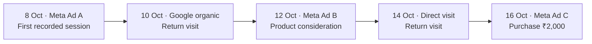

# First Click attribution and customer journeys

**SAADAA analytics · Team guide · 26 October 2026**

First Click compares the recorded visit that introduced a buyer with the session in which that buyer placed an order. It helps the team see which ads appear at the beginning and end of observed journeys, while using one **Ad spend** amount to compare the two revenue views.

The section gives full purchase credit to each end separately. An order worth ₹2,000 can contribute ₹2,000 to Ad A's first-click revenue and ₹2,000 to Ad C's last-click revenue. The business still received one ₹2,000 order. The two columns answer different questions about the same purchase.

This guide describes the **single Ad spend layout** in [PR 107](https://github.com/saadaa-sustainable/Backend_Project/pull/107), plus two later additions: the **"Window means"** control, which changes what the selected dates mean for the first-click side, and the two **lifetime columns**, which ignore the dates entirely. The journey rules come from the current GA4 extractor and dashboard API. Confirmed ingestion defects are documented under **Known data issues**; they have not been corrected by either change.

**Contents:** [Definitions](#what-first-click-and-last-click-mean-here) · [Example journey](#how-a-journey-starts-and-ends) · [Journey reconstruction](#how-the-system-reconstructs-the-journey) · [Date ranges](#how-the-selected-date-range-works) · [The "Window means" control](#the-window-means-control) · [Revenue and spend](#how-revenue-and-ad-spend-are-calculated) · [Lifetime columns](#lifetime-spend-ignores-the-selected-range) · [Worked calculations](#worked-example-with-four-orders) · [Table and cards](#how-to-read-the-table-and-cards) · [Filters and exports](#how-to-use-filters-and-exports) · [Last Click UTM comparison](#how-this-differs-from-last-click-utm) · [Data issues](#known-data-issues) · [Team questions](#questions-the-team-can-answer-with-this-section) · [Technical reference](#technical-reference-and-maintenance).

## What first click and last click mean here

| Term | Meaning in this project |
|---|---|
| First click | The earliest recorded session for the same GA4 browser identifier within the configured lookback before the converting session. |
| Last click | The latest eligible session at or before the converting session's start, normally the session containing the purchase. |
| Middle touch | Any observed session between those two endpoints. It contributes to journey length and session count, but receives no revenue credit in these two attribution models. |
| Lookback | Up to **90 days by default**, applied separately to each order. |
| Conversion | A GA4 purchase associated with a transaction ID. |
| Ad spend | The matched ad's or ad set's recorded Meta spend during the selected dashboard date range. |

**“Click” is the interface label for session-based attribution.** The pipeline reconstructs sessions from GA4 events; it does not identify the literal final mouse click before payment or attribute revenue to an ad impression. A direct visit, organic search visit or retention message can occupy either endpoint.

First click therefore means **first observed touch within the lookback**, not necessarily the customer's first interaction with SAADAA in their lifetime. It is also not a first-paid-click model: the extractor does not skip an earlier direct, organic or unlabelled session to find an ad.

## How a journey starts and ends

The following journey is illustrative, not a real customer record. The selected dashboard range is **10–16 October**.



| Visit | What the customer does | Attribution treatment |
|---|---|---|
| 8 October, Ad A | Discovers a product and leaves without purchasing. | Earliest eligible session: Ad A receives first-click credit when the later order is recorded. |
| 10 October, Google organic | Returns through a search result. | Middle touch: visible in the session count, with no credit in either endpoint model. |
| 12 October, Ad B | Returns through another ad and considers products. | Middle touch. This model does not estimate how much Ad B persuaded the buyer. |
| 14 October, direct visit | Returns without a paid-ad identifier. | Middle touch. Direct visits are retained when GA4 records them. |
| 16 October, Ad C | Returns through Ad C and purchases for ₹2,000. | Latest eligible session: Ad C receives last-click credit. |

Ad A receives ₹2,000 of first-click revenue. Ad C receives ₹2,000 of last-click revenue. Ad B receives no revenue from this order in either column, even though it may have influenced the decision.

The 8 October visit is outside the selected reporting dates but inside the order's lookback. It still receives first-click credit because the reporting range selects **orders**, not the date on which the first touch happened. Ad A's displayed spend is limited to **10–16 October**.

At **Ad** grain, this order changes hands from A to C. At **Source** grain, both endpoints are Meta, so it does not represent a source change. This distinction matters when reading the Reattributed card.

## How the system reconstructs the journey

### Events become sessions

The extractor reads the project's GA4 BigQuery export, currently `events_intraday_*`. It groups events by `user_pseudo_id` and the `ga_session_id` event parameter. The earliest event timestamp becomes the session start.

Traffic fields are taken from `collected_traffic_source`. In this store's implementation, `manual_content` is treated as the ad token and `manual_term` as the ad set token. These values can contain actual Meta IDs, names or another platform's tracking strings; their presence alone does not prove that they identify a Meta ad.

The current code uses `MIN()` to select non-null source, medium, campaign, ad and ad set values within a session. That chooses values alphabetically rather than chronologically. When multiple values occur in a session, the selected fields may not describe its entry event. This is a confirmed limitation, detailed below.

### A purchase identifies the converting session

Sessions containing a `purchase` event and a transaction ID become conversion candidates. The current extractor retains one transaction per session using `MIN(transaction_id)` and uses `MAX(purchase_revenue)` for that session. Multiple purchases in one session are therefore not handled correctly yet.

The resulting PostgreSQL table, `ga4_order_attribution`, is keyed by `transaction_id`. That key is intended to match Shopify's order `name`. The First Click endpoint reads GA4 attribution directly; it does not require a successful Shopify match before counting an order or replace its revenue with Shopify's order value.

### Earlier sessions are attached to each order

For a converting session, the query gathers sessions with:

1. The same `user_pseudo_id`.
2. A start time no later than the converting session's start.
3. A start time no more than the configured lookback before that start.

It ranks those sessions from earliest to latest. The earliest supplies the first-touch fields; the latest supplies the last-touch fields. Session ID breaks ties in session-start timestamps.

The identifier join does not merge histories by Shopify customer ID or email. A different device, browser identifier or missing tracking can leave earlier visits outside the reconstructed journey. The earliest visit the system sees is not proof that no earlier visit occurred.

### Each order has its own journey window

The lookback is recalculated for each purchase. A previous purchase does **not** automatically reset the next order's journey. An earlier session can remain eligible for several later orders while it stays inside their respective lookback windows.

For example, a buyer first observed on 1 October who purchases on 10 and 20 October can have that same 1 October session credited as the first touch for both purchases. These are two order journeys, not two newly acquired customers.

## How the selected date range works

Three time concepts must be kept separate.

| Time concept | What it controls |
|---|---|
| Reporting range | Which stored orders enter the table and headline order count. |
| Journey lookback | How far before each converting session the extractor searches for earlier visits. |
| Spend range | Which daily Meta spend records are added for each displayed ad or ad set. |

For **10–16 October**, the dashboard includes stored `order_at` values from 10 October at 00:00 IST through the end of 16 October. The upper boundary is exclusive: 17 October at 00:00 IST. Spend includes the stored Meta `day` values from 10 through 16 October, inclusive.

An order stored on 16 October can credit a first touch on 8 October. An order stored on 18 October is excluded from this selection, even if its first touch was on 12 October. Changing the date filter changes the order population and the spend range; it does not redefine the 90-day journey lookback.

**Current timestamp limitation:** `order_at` is populated from the converting session's start, not the purchase event timestamp. A session starting before midnight and purchasing after midnight can therefore be assigned to the earlier day. The API applies IST boundaries correctly to that stored timestamp, but the timestamp itself needs correction. The extraction script also selects its order refresh window using the session-start date in UTC.

This distinction explains how a date-filter calculation can reconcile perfectly to PostgreSQL while still disagreeing with the actual purchase day.

### The "Window means" control

The paragraphs above describe the default, **Order date**. A second setting, **First-touch date**, changes which date decides whether an order belongs in the selected range — and it changes it for the first-click side only.

| Setting | An order enters the first-click columns when | Last-click side |
|---|---|---|
| Order date (default) | the order **closed** in the selected range | unchanged |
| First-touch date | the journey **opened** in the selected range | unchanged |

The last-click side never moves because the last touch *is* the converting session: windowing it by order date and by last-touch date are the same operation. Measured across 1,477 entities present under both settings, last-click revenue, last-click ROAS, Ad spend and lifetime spend are identical; only first-click revenue changes.

**Why the default distorts first-click ROAS.** On Order date the numerator reaches back and the denominator does not. First-click revenue can come from journeys opened weeks earlier, while Ad spend covers the selected range only. Measured over a 30-day window at Ad grain, **30.4% of orders — 31.2% of first-click revenue — were opened before the window began**, with an average of 14.9 days to convert and a longest journey of 89 days. First-click ROAS consequently reads roughly 30–50% high for an established ad, and is unchanged only where the entity's whole life sits inside the range.

On First-touch date the first-click revenue and the Ad spend describe the same clicks, which makes the ratio a cohort measure rather than a reporting one.

**What First-touch date costs.** Two things, and both matter.

1. The two sides no longer cover the same orders, so the section stops reconciling against Last Click UTM. Use Order date for any reconciliation.
2. Journeys opened inside the range that have **not converted at all yet** carry no revenue, because an unconverted journey has no order record. This understates recent entities exactly as the default overstates older ones.

It does **not** lose orders that convert later. The setting follows the journey forward: taking a complete past month as the range, 19,889 journeys opened in it and **5,003 of them — 25.2%, ₹63.5L — closed in a later month**, all still counted.

**Which to use.** Order date answers "which entities were involved in the orders I received in this range", and is the better reporting view. First-touch date answers "of the journeys this entity opened in this range, what have they returned against what it cost", and is the better view for judging a single ad. A large disagreement between the two for one entity means it is living on journeys it started earlier.

## How revenue and Ad spend are calculated

### Revenue receives full credit at each endpoint

For an entity such as an ad:

```text
First-click revenue = sum of GA4 revenue for selected orders it opened
Last-click revenue  = sum of GA4 revenue for selected orders it closed
```

These are separate full-credit attribution models. The system does not split an order 50/50 between first and last touch, weight intermediate visits or allocate revenue in proportion to spend.

If the same ad opens and closes an order, its full value appears in both columns of that ad's row. Do not add the revenue columns together. Summing down one column is meaningful for the entities included in that view; the ad-level sum can be smaller than the source-level sum because some orders lack an ad ID at that endpoint.

### One shared spend amount is used

```text
Ad spend = sum of this entity's daily Meta spend in the selected range
```

At Ad grain, the source is `insights_daily_by_ad`. At Ad Set grain, it is `insights_daily_by_adset`. Spend is aggregated before joining it to the attribution results, so several orders or several matching sessions cannot multiply the ad's cost.

The full selected-range spend is included for a matched entity, including days within the range when it recorded no attributed orders. It is not limited to days on which an order converted. Spend from outside the selected range is excluded.

The table contains entities that appear at one or both journey endpoints. An ad with spend but no first- or last-touch orders in the selected population can be absent. **The table's spend total is therefore not automatically the entire Meta account spend.**

There is no separate first-click advertising charge and last-click advertising charge. The single Ad spend column is the common cost used for both comparisons.

### Lifetime spend ignores the selected range

```text
Lifetime spend = sum of this entity's daily Meta spend across all history held
```

The column deliberately ignores the date filter. It equals Ad spend for any entity whose whole life sits inside the selected range, and exceeds it for anything older — which is the comparison it exists to support.

The source is the same daily table, **not** `ad_insights`. That table holds one `all_days` row per ad covering whatever window each ad was last fetched in; those windows overlap and disagree, and it totals ₹69.8L against the daily table's ₹12.04 Cr. It cannot be used as a lifetime figure despite the name.

Daily spend history begins slightly before the GA4 attribution history, so an entity that spent in those first few days carries the cost without the matching revenue. The effect is small and makes the lifetime ratio conservative rather than optimistic.

### ROAS compares each revenue view with that same cost

```text
First-click ROAS = First-click revenue / Ad spend
Last-click ROAS  = Last-click revenue / Ad spend
```

The dashboard leaves a ROAS blank when spend is unavailable, spend is below **₹1,000**, or no orders are credited to that side. The ₹1,000 floor applies over the selected range. Exactly ₹1,000 qualifies.

A dash does not mean zero performance. It can mean that the denominator is unavailable or too small for the current display rule. A zero-value order can still establish an attribution endpoint and, with enough spend, produce a numerical 0.00 ROAS.

```text
Lifetime FC ROAS = Lifetime first-click revenue / Lifetime spend
```

Lifetime FC ROAS applies the same ₹1,000 floor, measured against lifetime spend rather than range spend. Read it beside First-click ROAS: where the range figure is higher, the entity is performing better lately than it has overall, and the dashboard tints that cell to make the comparison visible. Because it ignores the date filter entirely, it is unaffected by the windowing question the "Window means" control addresses.

First-click ROAS can look unusually high when an ad opened journeys before the reporting range and has little spend during the range in which those buyers purchase. This is the measured 30–50% effect described under "The 'Window means' control"; switching that setting to First-touch date removes it. Both columns are descriptive ratios, not measurements of incremental profit or proof that an ad caused the sale.

## Worked example with four orders

All values in this example are illustrative. The selected dates are **10–16 October**. All four orders are visible to GA4, all ad IDs resolve, and all three ads have sufficient recorded spend.

| Order | Revenue | First ad | Last ad | Journey duration | Sessions |
|---|---:|---|---|---:|---:|
| Order 1 | ₹2,000 | A | C | 8 days | 5 |
| Order 2 | ₹1,500 | A | A | 0 days | 1 |
| Order 3 | ₹3,000 | B | C | 2 days | 3 |
| Order 4 | ₹1,000 | C | B | 1 day | 2 |
| Total unique purchases | **₹7,500** | | | | |

Selected-range spend is ₹1,200 for A, ₹1,500 for B and ₹2,000 for C. The resulting table is:

| Ad | Ad spend | First-click revenue | Last-click revenue | First ROAS | Last ROAS |
|---|---:|---:|---:|---:|---:|
| A | ₹1,200 | ₹3,500 | ₹1,500 | 2.92 | 1.25 |
| B | ₹1,500 | ₹3,000 | ₹1,000 | 2.00 | 0.67 |
| C | ₹2,000 | ₹1,000 | ₹5,000 | 0.50 | 2.50 |
| Total | **₹4,700** | **₹7,500** | **₹7,500** | | |

Ad A opened Orders 1 and 2, so it receives ₹3,500 of first-click credit. It closed only Order 2, so it receives ₹1,500 of last-click credit. Its actual selected-range spend remains ₹1,200.

Ad C closed Orders 1 and 3, giving it ₹5,000 of last-click revenue. It opened Order 4, giving it ₹1,000 of first-click revenue. The two views describe different roles played by the same ad.

For this complete illustrative cohort, either revenue column divided by the single spend total is ₹7,500 / ₹4,700 = **1.60**. Do not use ₹15,000 as revenue, double the spend, or take a simple average of the displayed row ROAS values.

The duration and session averages use only orders an entity **opened**. Ad A's average duration is (8 + 0) / 2 = **4.0 days**, and its average session count is (5 + 1) / 2 = **3.0 sessions**. Last-touch-only orders do not enter those averages.

## How to read the table and cards

| Display | How to interpret it |
|---|---|
| Ad or Ad Set | The endpoint's ID, with a name where it matches the relevant Meta lookup. Unresolved tokens remain visible rather than having their orders silently dropped. |
| Channel | A representative recorded source label for that entity. The current query selects a stable label from its endpoint records; it does not normalize every spelling into a canonical channel. |
| Ad spend | One selected-range cost per matched entity. A dash means no matching spend value is available. |
| Window means | Whether the selected range filters the order date (default) or the first-touch date. Affects the first-click columns only. |
| First-click revenue | Full GA4 value of selected orders opened by the entity. |
| Last-click revenue | Full GA4 value of selected orders closed by the entity. |
| First-click and last-click ROAS | Each revenue column divided by the same Ad spend, subject to the display rules above. |
| Lifetime spend | Everything Meta has billed this entity across all history held, ignoring the selected dates. Equals Ad spend for an entity whose whole life sits inside the range. |
| Lifetime FC ROAS | Lifetime first-click revenue divided by lifetime spend. Tinted where the range's First-click ROAS exceeds it, meaning recent form is ahead of lifetime return. |
| Days to convert | Average complete 24-hour intervals from first session to stored order time, over orders opened by the entity; rounded to one decimal. |
| Sessions | Average recorded session count, including the converting session, over orders opened by the entity; rounded to one decimal. |
| First-click and last-click revenue cards | Totals of the currently returned rows, so changing the row limit can change these cards. |
| Orders card | All GA4-attributed orders in the selected stored-order window, including orders without usable ad IDs. It is not a Shopify order total. |
| Reattributed card | Orders whose first and last **source strings** differ. It remains source-based even when the table is grouped by Ad or Ad Set. |

The Reattributed card currently trims blank strings but does not merge case variants or source aliases. `META` and `Meta` can count as different sources. Ad A to Ad B can be an ad change while both have source `META`, leaving this source-change count unchanged.

The chart displays the difference between first-click and last-click revenue for the largest absolute differences among the returned rows. A positive difference means more opening credit; a negative difference means more closing credit. It is not an estimate of sales that would disappear if the ad were paused.

### Choosing a grain

**Ad** answers which recorded ad token opened or closed the order. **Ad Set** uses the corresponding ad set token. **Source** compares recorded sources, including `(none)` for missing or blank source values.

An unlabelled session is retained. `(none)` cannot safely be interpreted as exclusively direct traffic: missing tracking can produce it too. Source-level spend and ROAS are hidden because this endpoint has no defensible common spend denominator for every source, including Google, organic, affiliate and retention traffic.

Campaign grain is not offered. The stored GA4 campaign fields contain formats that do not reliably resolve to the Meta campaign keys used by this project.

## How to use filters and exports

1. Select the order date range. Prefer complete days when reconciling with Shopify or Meta; today's sources can have different ingestion cutoffs.
2. Choose Ad, Ad Set or Source according to the question. Keep the same grain when comparing periods.
3. Choose the row limit. The default is **200**. The **All** option requests up to **5,000** rows; check the displayed returned-versus-matched count for truncation.
4. Sort by Ad spend, revenue, ROAS, duration or sessions. Header sorting is applied by the server, so it can change which entities enter a limited result. Missing values stay last.
5. Read the revenue pair against the single Ad spend denominator. Check whether missing spend or a low denominator explains a blank ROAS.
6. Export after setting the desired row limit. CSV contains the returned rows and one `spend` field, not a hidden export of every matching entity.

The two revenue cards summarize displayed rows, while the Orders and Reattributed cards describe the full GA4 order window. Changing a limit or sort can therefore change displayed revenue without changing the order count. This is a population difference, not necessarily a calculation error.

Displayed money is rounded for readability. Use the exported values when reconciling decimals. The API caches each result for up to **15 minutes**; a browser reload may reuse a still-valid backend cache entry after ingestion has finished.

## How this differs from Last Click UTM

| Question | First Click section | Last Click UTM section |
|---|---|---|
| Main source | GA4 sessions and purchases. | Shopify orders and captured UTM attributes. |
| Reporting unit | Aggregated source, ad or ad set. | Individual orders with their resolved attribution fields. |
| Journey history | Searches earlier sessions for the same GA4 identifier. | Uses the order's available UTM data and the project's matching rules. |
| Last-click meaning | Latest eligible GA4 session in the reconstructed order journey. | The ad or other entity resolved from Shopify's captured UTM values. |
| Revenue basis | Stored GA4 purchase revenue. | Shopify order value. |
| Coverage | Orders observed by GA4 and retained by the extractor. | Orders available in the Shopify attribution layer. |

The **Last-click revenue column inside First Click** is therefore not guaranteed to match the separate **Last Click UTM** section. Coverage, timestamps, revenue values and matching rules differ. Reconciliation should start with the same transaction IDs and aligned dates before comparing ad-level totals.

## Known data issues

The following observations come from the **24 October 2026 validation**, not a continuously updated quality monitor. The broader database comparison covered **24 September–23 October**; the raw-event spot-check covered purchases on **23 October**.

### Confirmed extraction defects

| Issue | Observed evidence | Effect on interpretation |
|---|---|---|
| One transaction retained per session | Of 951 unique raw purchases on 23 October, 8 transactions worth ₹8,972.34 were missing. Those eight were the transactions discarded by the session's `MIN(transaction_id)`. | Some purchases never reach the attribution table. |
| Session-level maximum revenue | Four stored purchases differed from their raw purchase values; matched sample revenue was ₹2,119.13 higher overall. | Revenue can be attached to the wrong purchase value when a session contains several transactions. |
| Session start used as order time | All 943 matched sample transactions used session start as `order_at`; nine fell on a different IST day from their purchase event. | Date-filter totals can move between days. |
| Alphabetical traffic-field selection | 132 sampled purchases occurred in sessions with multiple sources. In four first-touch cases, the stored source differed from the chronological entry source. | Some first-touch labels are incorrect; fields should be selected together from an ordered event. |

The sample establishes these defects but does not measure their full historical impact. The spend-column change leaves the extractor unchanged.

### Coverage and metric limitations

In the 30-day audit window, First Click contained **29,990** attributed orders. Of **37,977** Shopify orders processed in that period, **28,624** had an exact transaction-name match somewhere in the GA4 attribution table: **75.37%** observed coverage. That matching count includes cross-day cases, so it is not a strict intersection of both date-filtered populations.

Within the GA4 reporting window, **1,370 transactions** had no exact Shopify order-name match. First Click still included their GA4 revenue. It also included **1,268 VOIDED** and **251 REFUNDED** Shopify orders. The metric is gross recorded purchase credit; it is not net realized revenue after cancellations, refunds, returns or fulfilment costs.

The audit found **898 Meta-first orders** whose ad tokens did not resolve by Meta ad ID. Some tokens were ad names: exact-name lookup was unique for 116 orders, ambiguous for 552 and absent for 230. A name match must not be treated as a safe ad ID mapping when several ads share that name.

These limitations affect how much confidence to place in a ranking. They do not mean the dashboard's aggregation is random: the audited Source, Ad and Ad Set totals reconciled to the stored data, including spend and ROAS. Correct arithmetic does not repair missing or mislabelled source records.

## Questions the team can answer with this section

**Which ads appear more often at the beginning of observed buying journeys?** Compare first-click revenue with last-click revenue for the same dates and grain. Investigate ads with a large positive difference, while checking mapping and spend availability.

**Which ads appear closer to purchases?** Review last-click revenue and its shared-spend ROAS. This indicates recorded closing credit, not proof that the ad alone generated the order.

**Should we pause an ad because its last-click ROAS is lower?** First-click credit can explain why a last-click-only view misses part of an ad's observed role. A pause decision still needs a broader assessment of spend, profitability, conversion lag, other journeys and data quality.

**Why is an active ad absent?** This table is built from attributed order endpoints. An ad can have delivery and spend without appearing at either endpoint in the selected population.

**Why are both revenue columns equal for an ad?** It may open and close the same purchases, or different orders may happen to total the same value. Equal totals alone do not establish that the underlying order sets are identical.

**Why is there only one spend column?** Meta charged one amount for that entity during the range. First-click and last-click attribution assign purchase credit differently, while both compare that credit with the same advertising cost.

## Technical reference and maintenance

| Component | Source and responsibility |
|---|---|
| Journey extraction | [`fetch_ga4_order_attribution.py`](../scripts/fetch_ga4_order_attribution.py): GA4 session aggregation, purchase candidates, lookback and endpoint selection. |
| Stored result | `public.ga4_order_attribution`: one stored row per retained transaction ID, with first/last identifiers, GA4 revenue and journey measures. |
| Dashboard calculations | [`analytics.py`](../app/api/routers/analytics.py), `_first_click_sql()` and `get_first_click()`: IST order-window filters, endpoint aggregation, daily spend joins, ROAS, sorting and headline counts. |
| Display and CSV | [`FirstClick.tsx`](../admin/src/app/user/analytics/FirstClick.tsx): filters, row limits, one Ad spend column, displayed-row revenue totals and export fields. |
| Refresh orchestration | [`refresh_all_daily.py`](../scripts/refresh_all_daily.py): the configured `ga4_attribution` step refreshes a rolling five-day order window. A successful scheduled trigger alone does not prove this step completed. |
| AI interpretation | [`assistant_analytics.py`](../app/services/assistant_analytics.py): the read-only First Click tool and its metric guidance. |
| Detailed audit evidence | [Validation notebook](../outputs/first-click-validation-2026-10-24/first-click-validation.ipynb), with saved SQL, aggregate results and the raw-event sample. This evidence is local to the project workspace. |

The extraction setting `GA4_ATTRIBUTION_LOOKBACK_DAYS` defaults to 90. Changing that setting does not automatically rewrite historical attribution: affected orders must be re-extracted to use the new lookback. Likewise, correcting transaction grain, timestamps or source selection requires a controlled backfill followed by reconciliation.

When reviewing a future change, verify purchase counts and values at transaction grain first, then check journey endpoints, spend aggregation and dashboard presentation. Preserve the distinction between **recorded attribution credit**, **actual advertising spend** and **realized business revenue** throughout.
