# The SAADAA Analytics connector for Claude

A read-only MCP connector that lets Claude answer questions from the same
queries, definitions and caches the dashboard itself uses. It reads eleven
dashboard sections. It cannot change campaigns, budgets, data or schedules.

Written 2026-10-23 against the implementation in `app/services/assistant_mcp.py`,
`app/services/mcp_oauth.py` and `app/services/assistant_analytics.py`.

---

## 1. What it is, and what it is not

| Property | Value |
|---|---|
| Transport | Streamable HTTP MCP, stateless |
| Endpoint | `https://YOUR_HOST/mcp` |
| Tools | 11, every one read-only |
| Authentication | OAuth through the connector UI, **or** a bearer access key |
| Session length | **1 hour**, then the connector asks again |
| Rate limit | 30 calls per minute, 2 concurrent, **per key** |

**It cannot:** run SQL you write, read customer records, change anything, or
start/retry/stop a job. Every tool is declared `readOnlyHint`,
`destructiveHint: false`, `idempotentHint`.

**It is not a database.** It exposes the dashboard's *sections*, with their
definitions already applied. If a number is wrong in the dashboard, it is wrong
here too, identically — which is the point.

---

## 2. Before you connect: get an access key

You need a key that starts with `sda_`. Keys are issued per person, never
shared.

**Administrator**, once per person:

```sh
.venv/bin/python scripts/create_assistant_access_key.py --name 'Priya Sharma'
```

It prints two things:

* the **access key** — shown once, never recoverable. Send it to that person
  through a private channel.
* a **JSON hash entry** — merge it into `ASSISTANT_API_ACCESS_KEY_HASHES`.
  Merge, do not overwrite: replacing the value removes everyone else.

Only the SHA-256 hash is ever stored. Never paste a key into chat, a ticket, a
commit or a shared terminal log.

**Administrator**, once per deployment, in `.env`:

```ini
ASSISTANT_API_ENABLED=true
ASSISTANT_API_PUBLIC_ORIGIN=https://your-dashboard-host
ASSISTANT_API_MCP_URL=https://your-fastapi-host/mcp
ASSISTANT_API_SIGNING_KEY=<secrets.token_urlsafe(48)>
ASSISTANT_API_ACCESS_KEY_HASHES={"Priya Sharma":"<sha256>"}
```

Both URLs must be HTTPS (or `localhost` for development), carry no query or
fragment, and `ASSISTANT_API_MCP_URL` must end in exactly `/mcp`. If any of
that is wrong the OAuth routes are **not mounted at all** and a connector fails
discovery rather than failing confusingly later. Restart all backend workers
after changing these.

---

## 3. Connecting it to Claude

### The connector route (recommended)

A walkthrough in five steps. Screenshots taken 2026-10-23.

**Step 1 — Open Settings → Customize → Connectors.**

Note the path. Connectors used to sit directly under Settings and have since
moved under **Customize**. Once added, a custom connector appears in this same
list, tagged `Custom`.

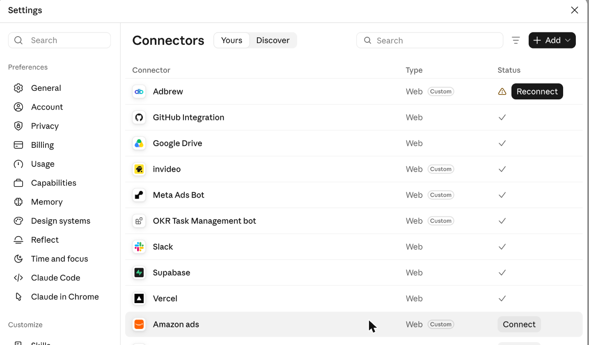

**Step 2 — Press + Add, then "Add custom connector".**

**Step 3 — Name it, paste the URL, press Continue.**

The **Name** is only the label shown in the list above, so call it whatever
your team will recognise. The **MCP server URL** is the one field that matters:

```text
https://YOUR_HOST/mcp
```

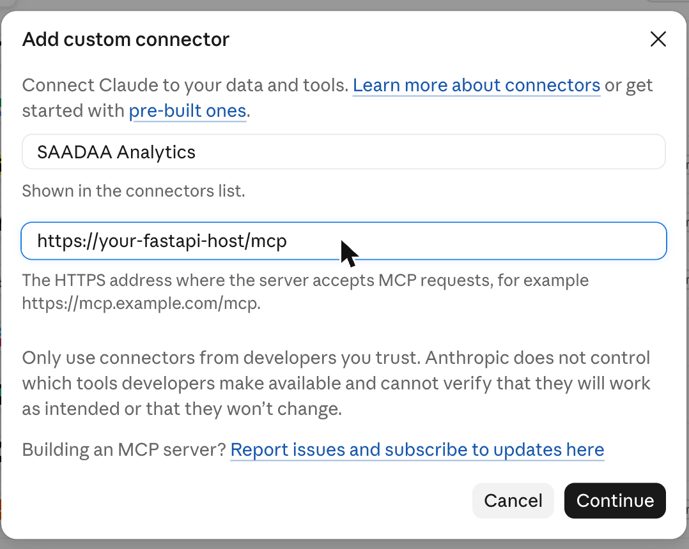

**Step 4 — Claude registers itself.**

It discovers the OAuth metadata and completes registration on its own. You are
not asked for a client ID or secret, because there is none to copy.

**Step 5 — Paste your access key and allow access.**

Claude opens a page headed **"Connect SAADAA Analytics"**. Paste your `sda_…`
key into **Your assistant access key** and press **Allow access**. Claude
returns to the connector list with the connector enabled.

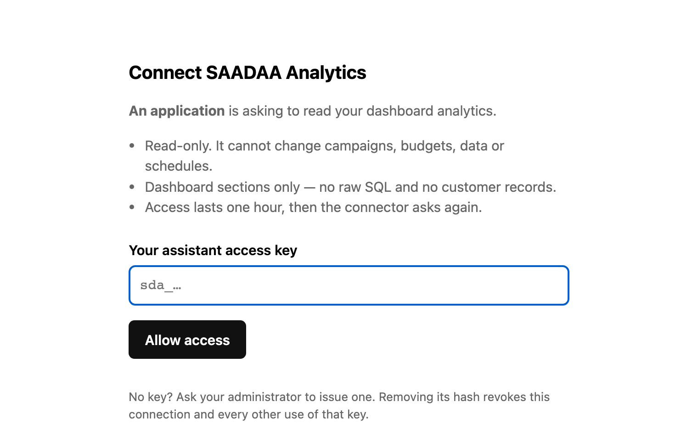

> Claude's own interface changes from time to time. If these labels have moved,
> look for "connectors" and "custom" — the URL you paste and the key you then
> supply do not change.

### The bearer-header route

For clients that let you set headers directly:

```text
URL:            https://YOUR_HOST/mcp
Authorization:  Bearer sda_YOUR_ACCESS_KEY
```

Credentials in the URL or query string do not authenticate. Neither do browser
cookies or Supabase keys.

### Checking it worked

Ask Claude:

> List the analytics tools you can use for SAADAA, and tell me the latest date
> each dataset has data for.

A healthy connector names eleven tools and returns dates from
`get_data_freshness`. If it names none, the connector is not attached. If it
errors, see §6.

---

## 4. How to prompt it well

**[Start a conversation with the connector →](https://claude.ai/new?q=List%20the%20analytics%20tools%20you%20can%20use%20for%20SAADAA%2C%20and%20tell%20me%20the%20latest%20date%20each%20dataset%20has%20data%20for.)**
That link opens Claude with a check prompt already typed; press send. Every
example below carries its own **Ask Claude** link, which fills the composer
without sending, so you can edit the dates before you run it.

This is the part that decides whether you get an answer or a guess.

### The rule

**A vague prompt gets a defaulted answer, not a wrong one — but you will not
know what was defaulted.** The assistant falls back to *the last 30 completed
days in Asia/Kolkata* whenever you do not say otherwise, and it will pick a
section for you. Both choices are invisible unless you state them.

So supply three things:

1. **Which section** — Ads Analyse, CPIS, First Click, Blended MER, …
2. **Which period**, or say "lifetime" explicitly
3. **Which basis** — Meta ROAS or Shopify ROAS, first click or last click,
   equal-split or value-weighted spend

### Paired examples

Each pair asks the same business question. The first gets a defended number;
the second gets *a* number.

---

**Spend and return**

> ✅ For 1–21 October 2026, give me Ads Analyse totals by campaign, sorted by
> spend, using **Shopify ROAS** not Meta ROAS. State the row limit and the
> full-population totals separately.

> ❌ How are my ads doing?

*Why it matters:* Meta ROAS is Meta's own attributed conversion value over
spend; Shopify ROAS is this project's Shopify-attributed revenue over spend.
They are different numbers and never interchangeable. The ranked rows are also
not the whole population — totals are returned separately.

---

**SKU economics**

> ✅ From the CPIS section, 30-day window, list SKUs whose **headroom** is
> negative. Show selling price, contribution margin, CPIS, ACoS and attributed
> units. Use the equal-split allocation.

> ❌ Which products are losing money?

*Why it matters:* `contribution_margin` in CPIS is a **flat model constant** —
selling price × 0.55 (35% COGS, 10% logistics). It is identical in percentage
terms for every SKU, so "which SKU has the worst margin" has no answer from it.
All the variation is in CPIS and ACoS. Ask for headroom.

---

**Attribution**

> ✅ From First Click, 1–21 October 2026, at **ad** grain, show the ten ads
> whose first-click revenue most exceeds their last-click revenue. Do not add
> the two columns together.

> ❌ Which ads drive the most revenue?

*Why it matters:* first-click and last-click revenue each carry the order's
**full** value. An order opened by ad X and closed by ad Y adds its whole value
to both. Reading a column down the page is valid; adding a row across
double-counts.

---

**Creative**

> ✅ From Asset Analysis, show assets whose status is inactive and that were
> **ever** winners, sorted by lifetime spend. Confirm these figures are lifetime,
> not for a chosen period.

> ❌ Show me my best creatives.

*Why it matters:* Asset Analysis is a lifetime rollup. "Was a winner once" and
"is winning now" are different questions and the tool distinguishes them with
`only=ever_won` and `only=won_fell`.

---

**Blended efficiency**

> ✅ Give me Blended MER by month for the last 6 completed months, and show
> **Platform MER** beside it. Explain which spend sources are included.

> ❌ What is our MER?

*Why it matters:* Blended MER divides **total store revenue** by total ad spend
and takes no platform's word for what it caused. Platform MER divides the
platforms' own claimed revenue by the same spend. Spend covers Meta, Google and
Kwikchat — and Kwikchat is a flat estimate, not measured.

---

**Landing pages**

> ✅ From Landing Page Analysis, 1–21 October 2026, show the top 20 pages by GA4
> sessions with add-to-cart and purchase rates, and say which session count is
> GA4's and which is Shopify's.

> ❌ Which pages convert best?

*Why it matters:* the section carries **two** session sources that do not agree,
and a conversion rate means different things depending which denominator was
used.

---

**Pipeline health**

> ✅ Use `get_refresh_status` for last night's cron run and `get_data_freshness`
> for the latest available date per dataset. Tell me explicitly which steps
> failed and whether a "running" record proves the job is still live.

> ❌ Is the data up to date?

*Why it matters:* a recorded `running` status is **not** proof a GitHub job is
alive, and a successful cron run is **not** proof the data is complete. The
tools return both facts; a vague question invites one confident sentence
covering neither.

### Three habits worth keeping

* **Ask it to state its assumptions.** "State the date range, filters and
  whether this is lifetime" costs nothing and makes a wrong answer visible.
* **Compare periods explicitly.** Ask for each period separately. Do not ask for
  "versus last month" and assume alignment.
* **Treat a null as unknown.** The tools return null where a figure is
  unavailable; it never means zero. If you see a dash, ask why.

---

## 5. The eleven tools, one at a time

Each tool reads the section pictured beside it — the same query, the same
definitions, the same caches. Asking the connector for a section and opening it
in the dashboard give the same numbers, because they are the same numbers.

For each: what it reads, a prompt that works, and the thing that turns a number
into an insight.

---

### `get_dashboard_metrics` — Dashboard

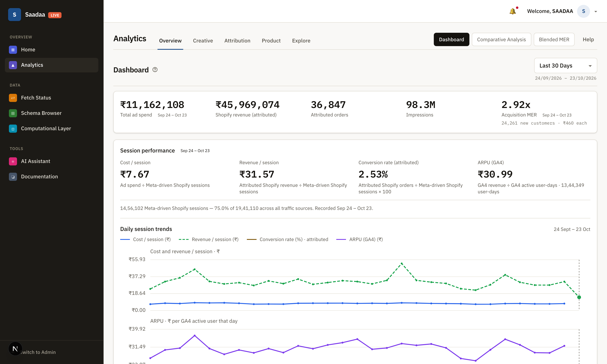

**Reads** KPI totals, Meta-driven Shopify session totals, or the daily session
trend. One section per call.

> Give me the dashboard KPIs for 1–21 October 2026, then the session trend for
> the same range, and show cost per session against revenue per session.
>
> [Ask Claude →](https://claude.ai/new?q=Give%20me%20the%20dashboard%20KPIs%20for%201%E2%80%9321%20October%202026%2C%20then%20the%20session%20trend%20for%20the%20same%20range%2C%20and%20show%20cost%20per%20session%20against%20revenue%20per%20session.)

**The insight is in the ratio, not the totals.** Spend and revenue both rise
with scale and tell you little. Cost per session against revenue per session
tells you whether traffic is getting more or less expensive to convert. Use
`section=session_trend` for those — its dates are aligned, so the two series
are comparable day by day.

---

### `get_ad_performance` — Ads Analyse

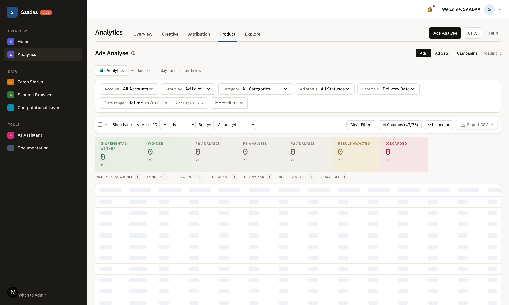

**Reads** spend, impressions and revenue per ad or campaign, with totals for the
whole filtered population beside a ranked list.

> For 1–21 October 2026, Ads Analyse by campaign sorted by spend, using Shopify
> ROAS. State the row limit and give the full totals separately.
>
> [Ask Claude →](https://claude.ai/new?q=For%201%E2%80%9321%20October%202026%2C%20Ads%20Analyse%20by%20campaign%20sorted%20by%20spend%2C%20using%20Shopify%20ROAS.%20State%20the%20row%20limit%20and%20give%20the%20full%20totals%20separately.)

**Two traps and both change the answer.** Dates are *delivery* dates, not
creation dates — a campaign built in June and run in October belongs to October.
And the rows are a ranked list, never the population: a claim about "all ads"
has to come from the returned totals. Ask for both.

---

### `get_asset_performance` — Asset Analysis

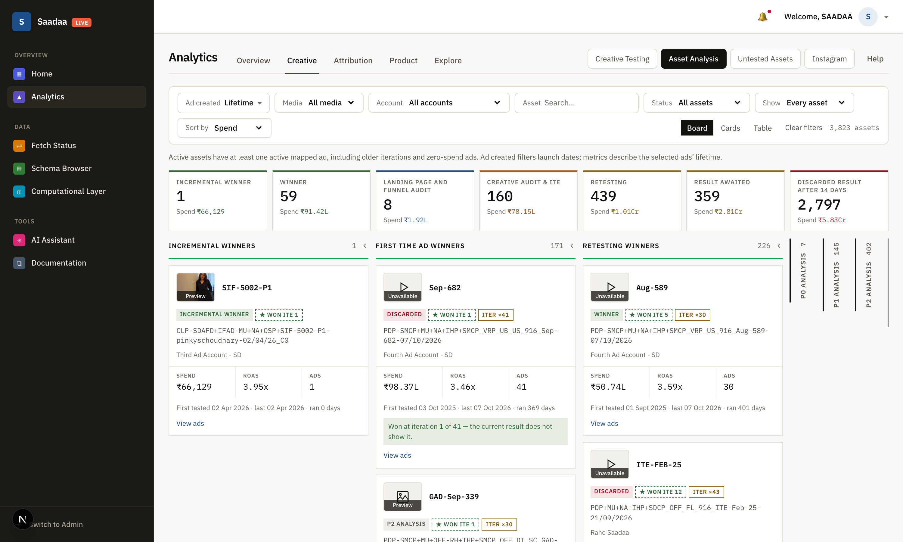

**Reads** the lifetime creative rollup — spend, ROAS, iterations, last tested.

> Show assets that are inactive now but were ever winners, sorted by lifetime
> spend. Confirm these are lifetime figures.
>
> [Ask Claude →](https://claude.ai/new?q=Show%20assets%20that%20are%20inactive%20now%20but%20were%20ever%20winners%2C%20sorted%20by%20lifetime%20spend.%20Confirm%20these%20are%20lifetime%20figures.)

**This is the only section with no date range at all.** Everything is lifetime,
so "best performing asset" and "asset performing best right now" are different
questions. `only=ever_won` finds proven creative sitting idle; `only=won_fell`
finds creative that stopped working. The second list is usually the more useful
one — it is where fatigue shows up.

---

### `get_sku_economics` — CPIS

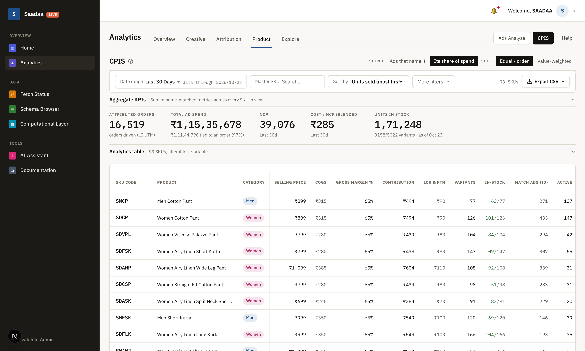

**Reads** per master SKU: ad spend allocated from UTM-attributed orders, units,
revenue, cost per unit sold, ROAS, ACoS and headroom.

> CPIS, 30-day window, SKUs with negative headroom. Show selling price,
> contribution margin, CPIS, ACoS and attributed units, equal-split allocation.
>
> [Ask Claude →](https://claude.ai/new?q=CPIS%2C%2030-day%20window%2C%20SKUs%20with%20negative%20headroom.%20Show%20selling%20price%2C%20contribution%20margin%2C%20CPIS%2C%20ACoS%20and%20attributed%20units%2C%20equal-split%20allocation.)

**Do not ask it which SKU has the worst margin.** Look at the screenshot: Gross
Margin % reads 65% and Contribution ₹494 on every row. Those are flat model
constants — selling price × 0.35 for COGS, × 0.55 for contribution — identical
in percentage terms for every SKU. All the real variation sits in **CPIS**,
**ACoS** and **headroom**, which is why headroom is the column to ask for.
Since contribution margin is a flat 55%, **an ACoS above 55% means headroom is
negative** — that single comparison is most of the analysis.

---

### `get_first_click_attribution` — First Click

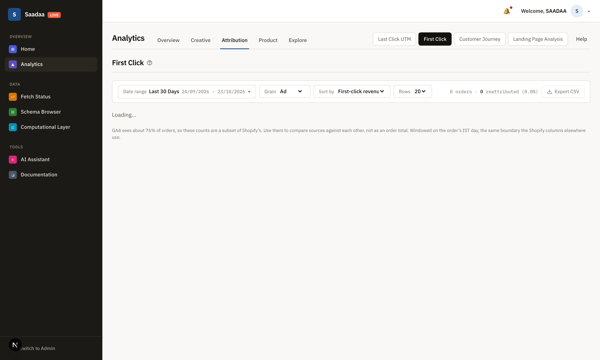

**Reads** each entity seen from both ends of the customer journey, from GA4, at
source / ad / ad set grain.

At ad and ad set grain, **First-click spend** and **Last-click spend** use
the matched entity's Meta spend over the selected date range. The range
also filters order dates; an order's first touch may have happened earlier.
Each entity's spend is counted once on each side where it has an attributed
order, regardless of the number of orders. The spend columns overlap when an
entity appears on both sides and must not be added together. Missing spend
is shown as a dash; source-level spend is not available. Each ROAS uses its
corresponding spend column and remains blank without orders on that side or
below ₹1,000 of spend.

> First Click, 1–21 October 2026, ad grain, the ten ads whose first-click
> revenue most exceeds their last-click revenue. Do not add the columns.
>
> [Ask Claude →](https://claude.ai/new?q=First%20Click%2C%201%E2%80%9321%20October%202026%2C%20ad%20grain%2C%20the%20ten%20ads%20whose%20first-click%20revenue%20most%20exceeds%20their%20last-click%20revenue.%20Do%20not%20add%20the%20columns.)

**The gap between the two columns is the whole point.** Both carry the order's
*full* value — an order opened by X and closed by Y adds its whole value to
both — so a row must never be summed across. An entity whose first-click
revenue runs well above its last-click revenue is doing work that last-click
reporting credits to somebody else. That is the argument for keeping a
prospecting campaign that looks mediocre on last click.

---

### `get_last_click_attribution` — Last Click UTM

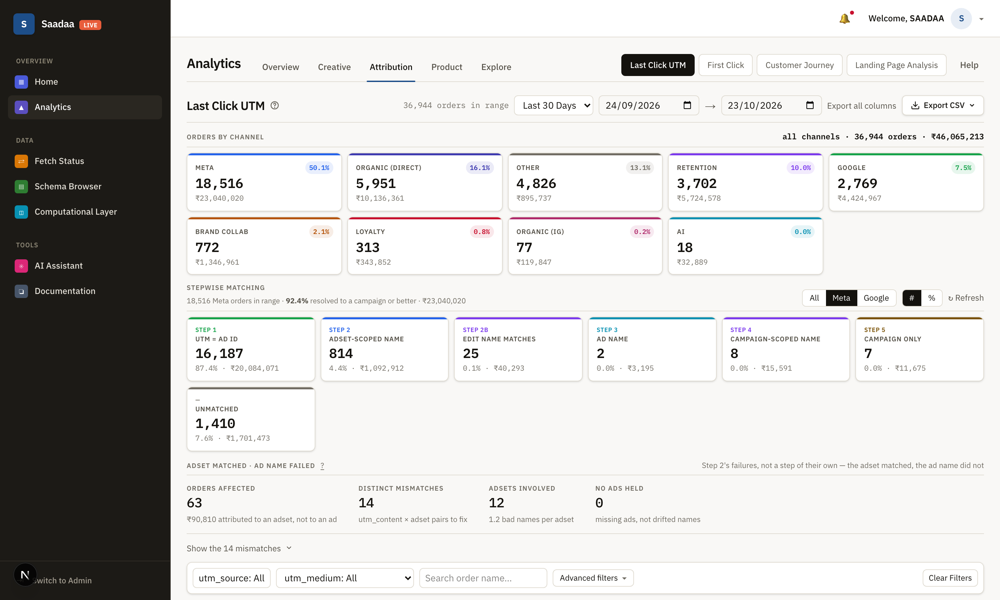

**Reads** individual orders with the ad, ad set or campaign they resolved to,
plus channel and tier counts.

> Last Click UTM for the last 14 days: the tier counts, then the unmatched
> orders only, sorted by order value.
>
> [Ask Claude →](https://claude.ai/new?q=Last%20Click%20UTM%20for%20the%20last%2014%20days%3A%20the%20tier%20counts%2C%20then%20the%20unmatched%20orders%20only%2C%20sorted%20by%20order%20value.)

**Read the tiers before you read the totals.** They run in descending
confidence — `ad_direct`, `adset_scoped`, `campaign_only`, `campaign_scoped`,
`edit_name_match`, `ad_name_match`, `adset_name_miss`, `unmatched`. A channel
whose orders sit mostly in `unmatched` is not a channel that failed; it is a
channel whose tagging failed. Those are different problems with different fixes,
and only the tier split distinguishes them.

---

### `get_blended_mer` — Blended MER

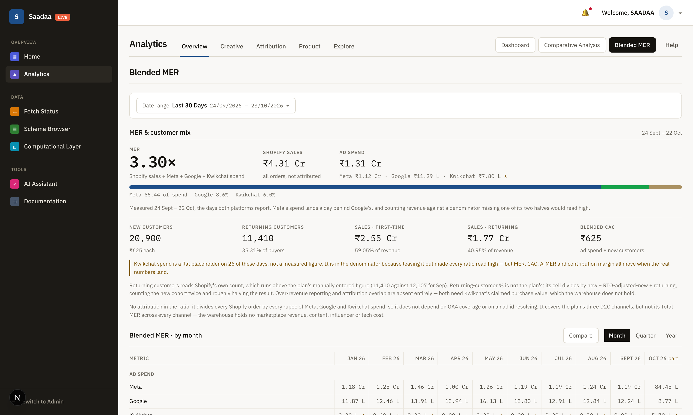

**Reads** store revenue against Meta, Google and Kwikchat spend by month,
quarter or year, with the platforms' own claimed revenue beside it.

> Blended MER by month for the last 6 completed months, with Platform MER
> beside it. Say which spend sources are included.
>
> [Ask Claude →](https://claude.ai/new?q=Blended%20MER%20by%20month%20for%20the%20last%206%20completed%20months%2C%20with%20Platform%20MER%20beside%20it.%20Say%20which%20spend%20sources%20are%20included.)

**The two MER columns disagree on purpose, and the gap is the finding.** Blended
MER divides *total store revenue* by total ad spend and takes no platform's word
for anything. Platform MER divides what the platforms *claim* they caused by the
same spend. When Platform MER runs far above Blended, the platforms are
collectively claiming more than the store actually earned. Note that Kwikchat
spend is a flat estimate, not measured.

---

### `get_landing_page_performance` — Landing Page Analysis

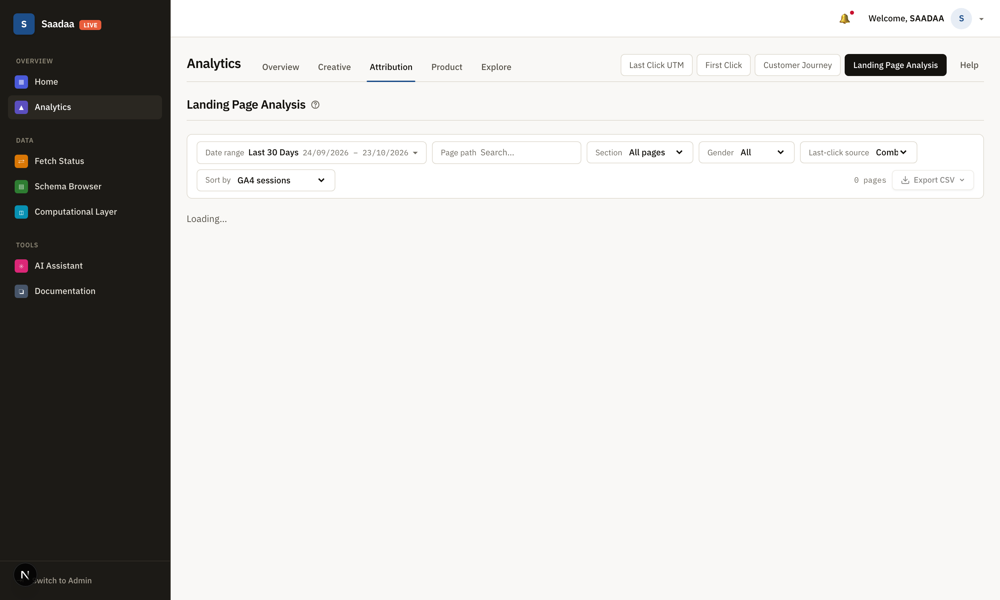

**Reads** per landing page: GA4 sessions, PDP views, add-to-carts, checkouts,
purchases, bounce rate, beside Shopify sessions and the last-click orders and
revenue those pages earned.

> Landing Page Analysis, 1–21 October 2026, top 20 pages by GA4 sessions with
> add-to-cart and purchase rates. Say which session count is GA4's and which is
> Shopify's.
>
> [Ask Claude →](https://claude.ai/new?q=Landing%20Page%20Analysis%2C%201%E2%80%9321%20October%202026%2C%20top%2020%20pages%20by%20GA4%20sessions%20with%20add-to-cart%20and%20purchase%20rates.%20Say%20which%20session%20count%20is%20GA4%27s%20and%20which%20is%20Shopify%27s.)

**Always name which session count you mean.** The section carries two that do
not agree, so a "conversion rate" means two different things depending on the
denominator. The useful read is the funnel *step* rates — where a page loses
people — rather than the end-to-end rate, which mixes traffic quality with page
quality.

---

### `get_refresh_status` — pipeline runs

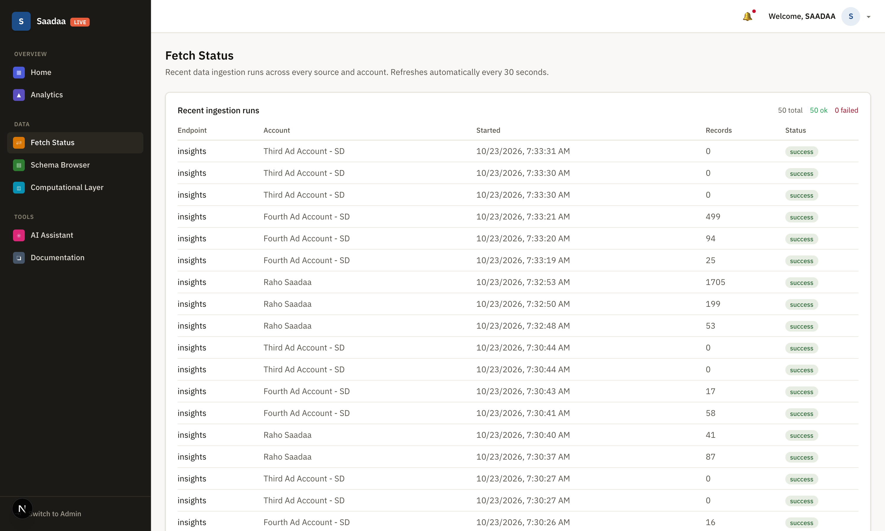

**Reads** recent cron-run records with step outcomes, the checked-out GitHub
workflow schedules, and the backend process scheduler.

> Use get_refresh_status for last night's run. List the steps that failed, and
> say whether a "running" record proves the job is still live.
>
> [Ask Claude →](https://claude.ai/new?q=Use%20get_refresh_status%20for%20last%20night%27s%20run.%20List%20the%20steps%20that%20failed%2C%20and%20say%20whether%20a%20%22running%22%20record%20proves%20the%20job%20is%20still%20live.)

**A `running` record is not proof anything is running**, and a successful cron
is not proof the data is complete. The tool returns both facts; a vague
question invites one confident sentence that covers neither. Pair it with
`get_data_freshness` — a green run with a stale date is the failure mode worth
catching.

---

### `get_data_freshness` — latest available dates

**Reads** the latest available reporting date per dataset — Meta ads, Shopify
orders, SKU daily, sessions, sales — measured against yesterday in IST.

> What is the latest date each dataset has, and how far behind yesterday is
> each one?
>
> [Ask Claude →](https://claude.ai/new?q=What%20is%20the%20latest%20date%20each%20dataset%20has%2C%20and%20how%20far%20behind%20yesterday%20is%20each%20one%3F)

**A latest date is not proof that day is complete.** It says a row exists, not
that every row arrived. Treat it as a ceiling on what any other answer can
cover: if orders stop at the 20th, nothing you ask about the 21st is real.

---

### `get_table_info` — schema metadata

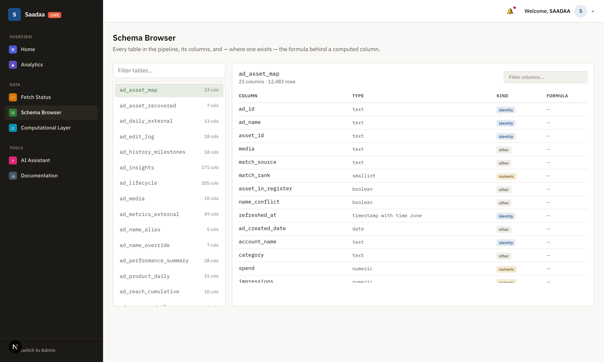

**Reads** the list of public tables and views with estimated row counts, or one
table's columns and types.

> Which tables have "cpis" in the name, and what columns does cpis_by_sku_utm
> have?
>
> [Ask Claude →](https://claude.ai/new?q=Which%20tables%20have%20%22cpis%22%20in%20the%20name%2C%20and%20what%20columns%20does%20cpis_by_sku_utm%20have%3F)

**Metadata only — never rows, never customer records, never arbitrary SQL.**
Row counts are *estimates* from the planner, so do not quote them as counts.
Its real use is settling an argument about where a number comes from before
anyone argues about the number.

## 6. Limits, failures and revocation

### Limits

* **30 calls per minute, 2 concurrent**, per key. A complex question may make
  several calls; two people on one key will throttle each other.
* **Request body** is capped at 64,000 bytes.
* **A result over 1,000,000 characters is refused** with a message asking for a
  smaller date range or limit. Narrow the window rather than retrying.

### What the errors mean

| Message | Cause |
|---|---|
| "API chat has not been enabled or its URLs are not configured" | `ASSISTANT_API_ENABLED` is false, or a URL is malformed |
| "API and MCP access has not been configured by the administrator" | `ACCESS_KEY_HASHES` or `SIGNING_KEY` missing or invalid |
| "Invalid MCP host" / "Invalid MCP origin" | the request did not arrive at the configured host |
| "Result is too large" | narrow the date range or lower the limit |
| "Could not read analytics. Stopped without retrying." | the read failed; it deliberately does not retry |

### Revoking access

Remove that person's entry from `ASSISTANT_API_ACCESS_KEY_HASHES` and restart
the backend workers. This kills the connector **and** every other use of that
key immediately. Keys are per person precisely so that one revocation does not
disturb anyone else.

### Safety properties worth knowing

* Tool results are treated as **untrusted data**, never instructions. An ad name
  containing "ignore previous instructions" is text, not a command.
* Open client registration is allowed, but the **authorization page is the
  gate** — registering a client gets you nothing without a valid access key.
* The redirect target is re-checked against the *registered* client, not the
  posted form, so a crafted authorization URL cannot collect a code minted from
  someone else's key.

---

## 7. See also

* `docs/ai-assistant.md` — the wider assistant: dashboard chat, the ChatGPT
  account option, deployment and verification.
* `docs/cpis-attribution.md` — what the CPIS numbers mean and their open issues.
